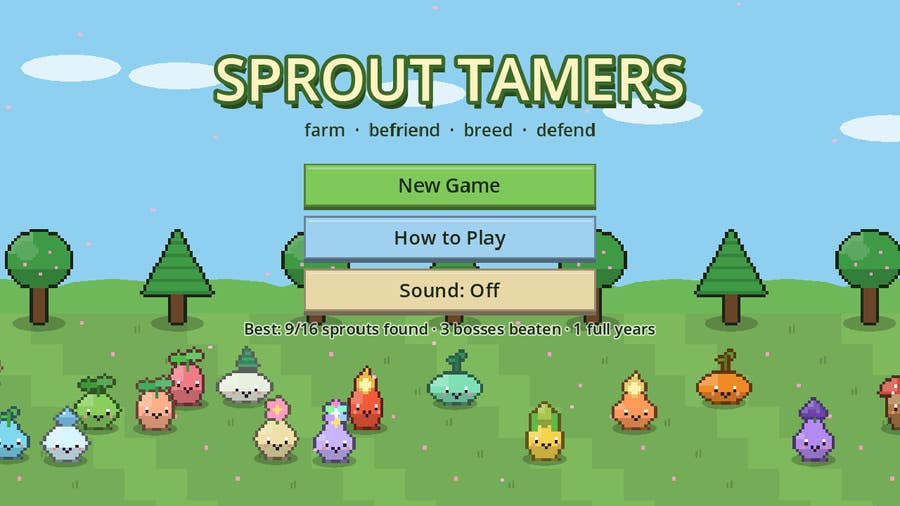
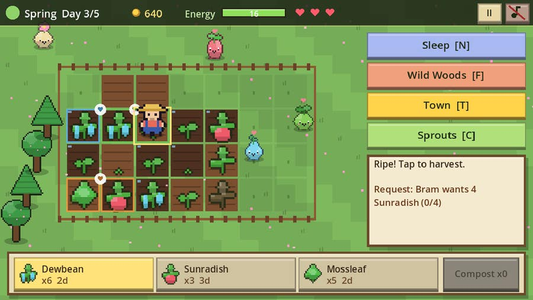
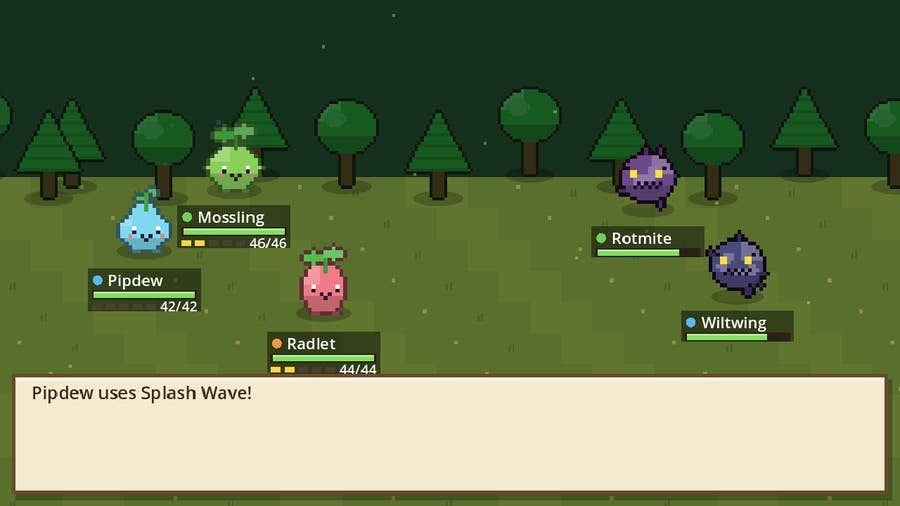
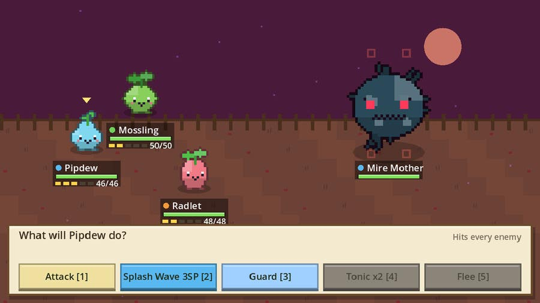
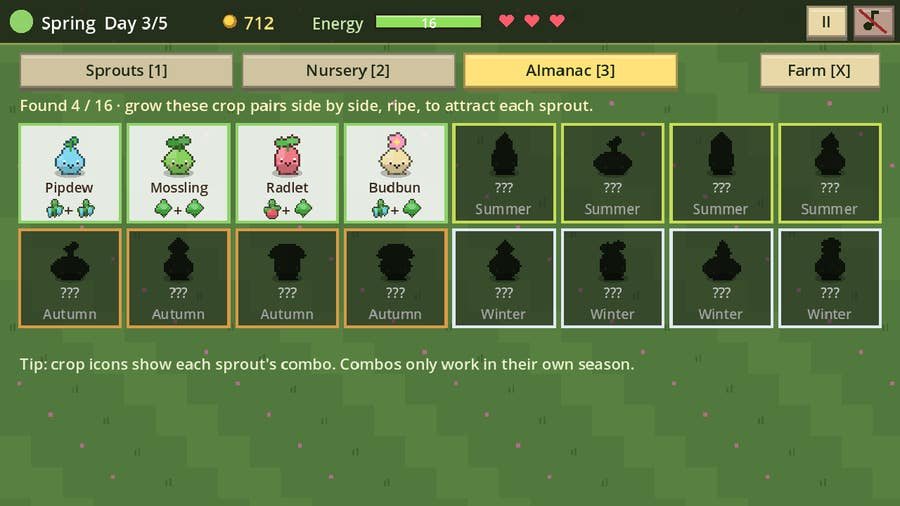
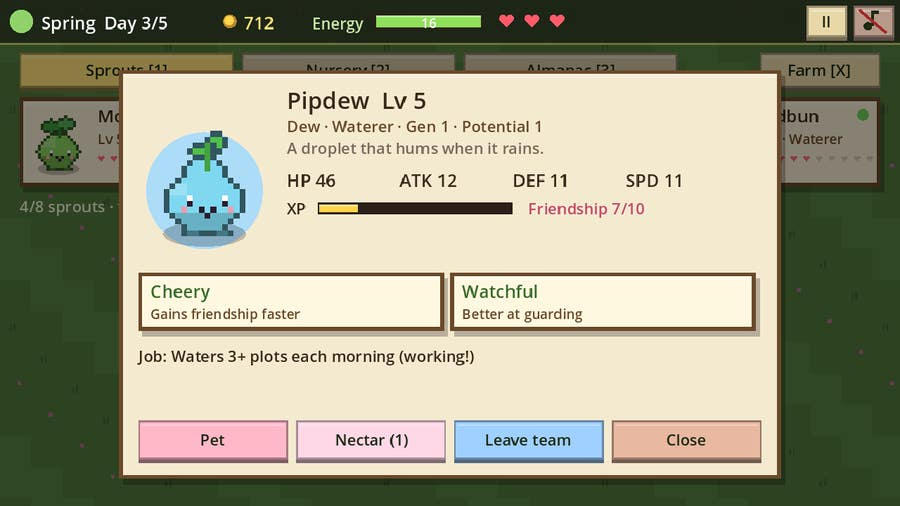
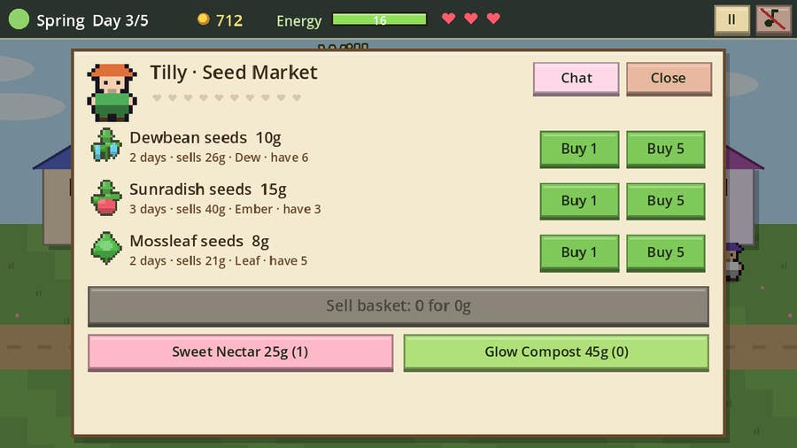
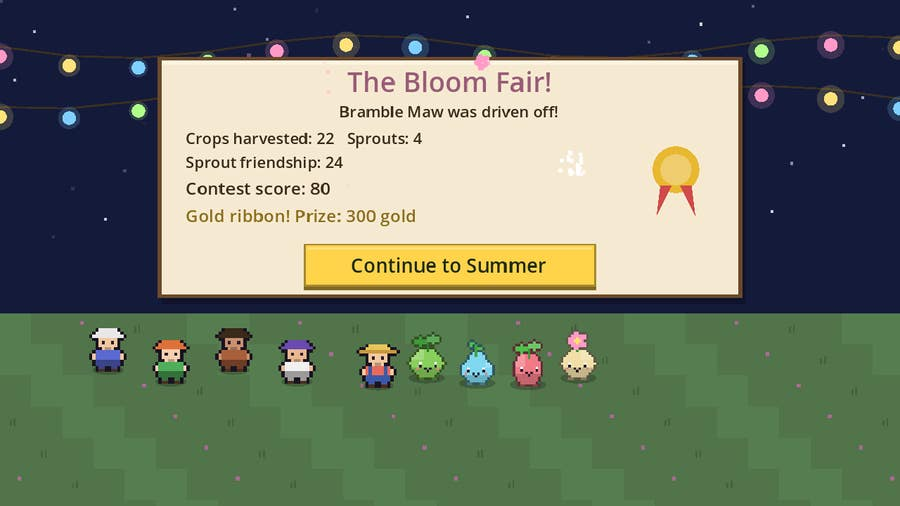
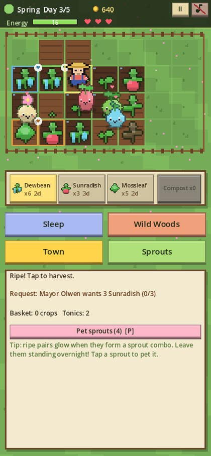
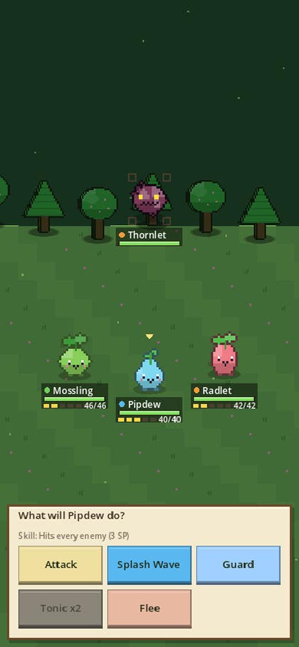

<div align="center">

# 🌱🐾 SPROUT TAMERS

### Farm the seasons. Befriend the sprouts. Beat back the blight.

An original **pixel-art farming + creature-taming game** made in **Godot 4**.
Grow crops side by side to attract **16 plant-spirit sprouts**, befriend and **breed** them for traits, let them water, harvest and guard your fields, and fight the blight in light **turn-based battles**.

[](https://jaigod.github.io/sprout-tamers/play/)

[](https://jaigod.github.io/sprout-tamers/)
[](https://godotengine.org)
[](https://github.com/JaiGod/sprout-tamers/actions/workflows/pages.yml)
[](LICENSE)


</div>

---

## 📸 Screenshots

| Title screen | The farm |
|:---:|:---:|
|  |  |
| **Blight battle** | **Season boss** |
|  |  |
| **Sprout almanac** | **Sprout details & traits** |
|  |  |
| **Tilly's seed market** | **The season festival** |
|  |  |

<p align="center"><b>On a phone</b><br> </p>

## 🔗 Links

- ▶ **Play:** <https://jaigod.github.io/sprout-tamers/play/>
- 🏡 **Landing page:** <https://jaigod.github.io/sprout-tamers/>
- 🧩 **Source:** [`scripts/`](scripts) · [`scenes/`](scenes) · [`tests/`](tests) · [`web/`](web) · [`.github/workflows/`](.github/workflows)
- ⚙️ **Builds:** [GitHub Actions](https://github.com/JaiGod/sprout-tamers/actions)
- 👑 **Org:** [JaiGod on GitHub](https://github.com/JaiGod)
- 🎮 **More JaiGod games:** [Pocket Wilds](https://jaigod.github.io/pocket-wilds/) · [Moonfarm](https://jaigod.github.io/moonfarm/) · [Harvest Hollow](https://jaigod.github.io/harvest-hollow/) · [Runebound Saga](https://jaigod.github.io/runebound-saga/) · [Iron Oath Tactics](https://jaigod.github.io/iron-oath-tactics/) · [The Hollow Between](https://jaigod.github.io/the-hollow-between/)

## ✨ Features

- 🌾 **Farming in four seasons** with 12 crops (3 per season). One contextual action tills, plants, waters or harvests. Watered crops grow overnight; out-of-season crops return to the soil.
- 🌱 **Crop combos attract sprouts.** Two ripe crops on neighbouring plots form a combo (they glow!). Overnight, the matching sprout moves in. 16 sprouts, each with its own combo, listed in the **Almanac**.
- 🧑‍🌾 **Sprouts work the farm by trait and job.** *Waterers* water plots each morning, *Harvesters* gather ripe crops (leaving combos alone), *Guardians* chase off night-time blight mites. Traits like *Dewy*, *Lucky*, *Green Thumb* and *Watchful* change how well they work.
- 💞 **Befriend & breed.** Pet each sprout once a day, share Sweet Nectar and battle together. Two sprouts with 6+ friendship breed at the Nursery: the seedling takes a parent's species, one trait from each parent, +1 potential, and sometimes a brand-new mutated trait.
- ⚔️ **Light turn-based battles** in the Wild Woods (3 areas). Speed-ordered turns, SP-powered skills (*Vine Lash*, *Splash Wave*, *Sun Flare*), Guard, Dew Tonics and a **Leaf > Dew > Ember > Leaf** triangle.
- 👹 **A blight boss ends every season**: Bramble Maw, Cinder Wilt, Mire Mother and The Hollow Rot (who shifts element every turn). Lose and a Heartroot is torn out. Lose all three and the farm withers.
- 🏘️ **Town of Willowmere** with 4 villagers: Mayor Olwen's daily requests, Tilly's seed market, Bram's workshop upgrades (field expansions, Lantern Ward, Copper Can, Heartroot Graft) and Juniper's sprout clinic.
- 🎉 **Season festivals** (Bloom Fair, Sunfire Night, Lantern Harvest, Frostlight Gala) score your harvest, sprout friendship and town hearts for a Gold / Silver / Bronze ribbon.
- 🎨 **Everything is made in code:** every sprite is painted pixel by pixel at startup, every sound and song is synthesized. No image or audio files.
- 💾 **Auto-saves** to `user://` every morning (IndexedDB in the browser), plus best records on the title screen.
- 🕹️ **Keyboard, mouse and touch**, a phone layout that re-flows for portrait screens, pause menu and sound toggle.

## 🎮 Controls

| Input | Action |
|---|---|
| Tap / click a plot | Do the next job there: till → plant → water → harvest |
| Arrows / WASD + **Z** / Space | Move the farmer and act |
| **Q / E** or **1-3** | Choose seeds |
| **N** · **F** · **T** · **C** · **P** · **G** | Sleep · Wild Woods · Town · Sprouts · Pet · Use Compost |
| Tap a sprout on the farm | Pet it (once a day) |
| Battle **1-5** (or Z/X/G/T/R) | Attack · Skill · Guard · Tonic · Flee |
| ← → / tap an enemy | Change target |
| Menus | Arrows + Z/Enter, X/Backspace to go back |
| **Esc** · **M** | Pause · Sound on/off |

## 🛠️ Tech stack

- **Godot 4.3**, GDScript, **Compatibility renderer** (WebGL 2) so it runs everywhere
- **Immediate-mode UI**: every screen is drawn with `_draw()` each frame and buttons register themselves while drawing, so one code path serves mouse, touch and keyboard focus
- Procedural pixel art (`Image.set_pixel` + outline pass) and procedural audio (`AudioStreamWAV` synthesis)
- **GitHub Actions** with `barichello/godot-ci:4.3`: headless smoke test → Web export (threads off, no COOP/COEP needed) → screenshots captured under Xvfb → GitHub Pages

## 📁 Project structure

```
sprout-tamers/
├── project.godot            # Godot 4.3, Compatibility renderer, canvas_items stretch
├── export_presets.cfg       # Web preset (threads off)
├── scenes/Main.tscn         # the single game scene
├── scripts/
│   ├── Data.gd              # crops, 16 sprouts + combos, traits, blights, bosses, villagers (autoload D)
│   ├── Game.gd              # farm sim, sprout jobs, breeding, town economy, save/load (autoload G)
│   ├── Battle.gd            # pure turn-based battle rules (no drawing, unit-testable)
│   ├── Art.gd               # pixel sprites painted in code (autoload Art)
│   ├── Sfx.gd               # synthesized sound effects + songs (autoload Sfx)
│   ├── UIKit.gd             # immediate-mode drawing helpers, particles, toasts
│   ├── Main.gd              # main loop, input, title, farm, woods, festival, endings
│   ├── Fight.gd             # battle screen: event playback, juice, input
│   ├── Town.gd              # Willowmere: market, workshop, clinic, requests
│   └── Herd.gd              # sprout roster, nursery (breeding), almanac
├── tests/
│   ├── Smoke.tscn / smoke.gd   # headless smoke test (prints SMOKE OK)
│   └── Shots.tscn / shots.gd   # screenshot capture (needs a display / Xvfb)
├── web/index.html           # landing page (deployed at /, the game is at /play/)
├── docs/screenshots/        # README pictures
└── .github/workflows/pages.yml
```

## 🚀 Run locally

1. Install [Godot 4.3](https://godotengine.org/download) (standard build).
2. Clone and open the project:
   ```bash
   git clone https://github.com/JaiGod/sprout-tamers.git
   godot --path sprout-tamers            # or open project.godot in the editor and press F5
   ```
3. Run the smoke test:
   ```bash
   godot --headless --path sprout-tamers --import
   godot --headless --path sprout-tamers res://tests/Smoke.tscn   # prints SMOKE OK
   ```
4. Web build: install the 4.3 export templates, then
   ```bash
   godot --headless --path sprout-tamers --export-release "Web" build/play/index.html
   python3 -m http.server -d build 8000   # open http://localhost:8000/play/
   ```

## 📓 Development log

**Concept.** I wanted a farming game that is not just "plant, wait, sell". The hook is that *where* you plant matters: neighbouring ripe crops form combos that attract sprouts, and the sprouts then change how the farm runs. That ties farming, collecting and battling into one loop: crops → sprouts → stronger team → safer farm → more crops. It plays very differently from my other farming games (Moonfarm is base-building on the Moon, Harvest Hollow is a cozy life sim) and from Pocket Wilds (no wild catching: sprouts come to you because of your garden).

**Design decisions**
- **One contextual farm action.** Tilling, planting, watering and harvesting are all the same tap. This made touch play easy and kept the toolbar to just a seed picker.
- **Combos stay standing.** Harvester sprouts skip crops that are part of a combo, otherwise your own helpers would eat the bait.
- **Breeding is about traits, not stats.** A seedling takes one trait from each parent, +1 potential, and a 20% chance of a new trait, so you breed toward the farm you want (Dewy waterers, Watchful guards, Lucky harvesters).
- **Battles are short.** 1-3 enemies, five buttons, element triangle, SP for skills. The boss fights are the real test, and losing costs a Heartroot instead of ending the run straight away.
- **Battle rules are pure logic** (`Battle.gd`) that return event lists; `Fight.gd` only animates them. That let the smoke test play hundreds of full battles headless.

**Challenges & fixes**
- *Phones were unreadable.* At 390 px wide the 400×260 base resolution made text tiny. The game now switches `content_scale_size` to 260×260 when the window is portrait, and every screen has a narrow layout (two-row HUD, stacked buttons, shorter labels).
- *Missing glyphs.* Godot's built-in font has no ♥ or ♪, which showed up as boxes, so hearts and the music-note icon are now drawn with shapes.
- *Battle labels overlapped* when three sprouts stood in a column; units are now staggered left/right.
- *Headless UI test was too slow* because battle animations are time-based; the smoke test runs with `Engine.time_scale = 20`.
- *Multi-line lambdas* inside function calls are fragile in GDScript, so transitions call named callbacks instead.

**Testing**
- Headless smoke test (data integrity, farming, combos, breeding, town economy, 16 battles incl. all 4 bosses, all seasons, save/load round trip, and every screen in landscape *and* portrait) runs in CI on every push.
- Played the local web export with Playwright at 1280×720 and 390×844: zero console errors, no horizontal scroll.
- Beta tested on the live site ✅ (2026-11-06): booted /play/ past the loading bar, started a farm, farmed, slept, fought in the woods and checked the console.

---

<div align="center">

Made by Jaineil Rana (JaKing) · part of [JaiGod](https://github.com/JaiGod)

</div>
